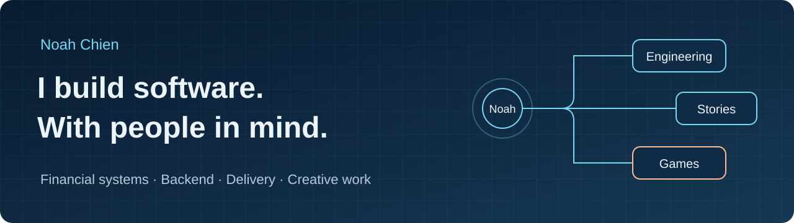

# Noah Chien

[繁體中文](README.md)　／　**English**

**Project Manager / Senior Software Engineer**　|　10+ years in software development

  

[Portfolio website](https://noahchien.github.io/portfolio/en.html)　·　[Engineering](projects/work.en.md)　·　[Background](about.en.md)　·　[Writing](projects/novel.en.md)　·　[Games](projects/cryptfall.en.md)

I've built speech applications and insurance, trust, and securities systems, working as a developer, systems analyst, and project lead. I currently run risk-control and trading systems at Concords Securities. My recent focus is low-latency trading on FPGA: I took over as project manager of a five-year university partnership in its third year, and after the development team shrank from three people to one, development finished more than a year ahead of the original schedule.

I'm good at problems nobody on the team knows well and that don't have enough people behind them. I start by getting the requirements and the current state straight, find what is actually blocking progress, and when it helps, write a tool so the team stops hitting the same wall.

## Selected work

| Project | Problem | What I did |
| --- | --- | --- |
| **FPGA pre-trade risk control** | Move a broker's pre-trade risk checks into an FPGA, with the team reduced from three people to one | Led planning and development. Went from feasibility study to orders filled and cancelled on the stock exchange's test environment in five months. Risk check inside the FPGA takes about 0.36 µs |
| **Options arbitrage FPGA, hardware debugging** | A university-built system passed every simulation but kept misbehaving on live market data | Led the late-stage hardware debugging and fixes. In a same-night, same-feed comparison, erroneous orders dropped from 60 to 0 |
| **Virtual exchange** | The risk team tested by hand, edge cases went untested, and production incidents were hard to reproduce | Built a test tool with scripted scenarios, automated stress tests, and log replay |
| **Logger Monitor** | Several teams read logs by hand and sometimes missed problems | Built a configurable log checker that alerts through LINE and Telegram |

## Low-latency trading on FPGA

This was a five-year university partnership. I took over as project manager partway through its third year, responsible for integration, development, and validation. Two systems came out of it: the university's arbitrage system, which I made work on real hardware, and a new risk-control system that I led.

### Pre-trade risk gateway (led)

Every order has to pass price, credit-limit, and inventory checks before it goes out. Server software used to do this. This project moved the checks into an FPGA so they finish in a fixed amount of time.

| Area | Details |
| --- | --- |
| Rules | Extracted the rules from two generations of existing risk systems, resolved 57 differences between them, and turned them into a machine-readable rule table that both development and testing work from |
| Latency | 109 clock cycles at 300 MHz, about 0.36 µs, for one order's risk check inside the FPGA. Network round trip is not included |
| Validation | Fed the same orders to a reference model of the current system and to the FPGA and compared every decision. After moving to hardware, compared hardware against simulation, and used 12 deliberately corrupted data sets to prove the comparison catches errors |
| Exchange | Logged in, had orders filled, and cancelled orders on the stock exchange's test environment. Cancel messages don't carry the full original order, so the FPGA keeps a copy when the order goes out and fills in the gaps itself. The exchange confirmed cancellations within 3 ms |
| Reliability | Timing closure at 300 MHz. Session sequence numbers and reconnect rules prevent duplicate orders; when state is uncertain, the system stops for manual review |

I owned planning, technical direction, code review, and validation, and used AI tools heavily for implementation. The system is the base for a follow-on project and is not in production yet.

`Alveo U50` · `HLS C++` · `10G Ethernet / TCP` · `FIX 4.4` · `300 MHz`

### Options put-call parity arbitrage (late-stage debugging and exchange integration)

The university team built the first version. It passed simulation but kept failing on live data. I led the late-stage hardware debugging, the fixes, and the connection to the futures exchange.

- **Erroneous orders, 60 → 0:** Read counters stage by stage and traced the problem to a variable that hardware synthesis had turned into a constant. After the fix, a same-night, same-feed comparison went from 60 erroneous orders to 0.
- **Symbol matches, 0 → 241,770:** The market-data format didn't match the decoder. After rewriting the decoder, matching worked again in that test run.
- **Exchange connection:** Connected the FPGA to the production market-data feed and had it log in to the futures exchange on its own. Logins kept failing and looked like a hardware fault; the real cause was the host and the FPGA sharing one network address. With the host's interface turned off, both the futures and options sessions logged in.
- **Market-data channels:** Worked out how to obtain the exchange's aggregated feed and its tick-by-tick feed, and confirmed the FPGA receives the tick-by-tick feed reliably.

[Full FPGA case study](projects/fpga.en.md)

## Virtual exchange

The risk-control developers tested by hand, so many edge cases never got tested, and problems seen in production were hard to recreate.

I built a virtual exchange for them:

- Scripts define the edge cases to test
- Automated stress tests
- Real logs can be imported and replayed

A problem that happened once in production can now be reproduced in testing and investigated at leisure.

[Testing tools](projects/testing-tools.en.md)

## Logger Monitor

Several IT teams checked their logs by hand and things slipped through. I built Logger Monitor for them to share:

| Check | How |
| --- | --- |
| Log file exists | Confirms the expected files are there |
| Errors | Searches for ERROR, abort, catch, and similar keywords |
| Team-specific needs | Checks are configured in INI files |
| Alerts | Sends notifications through LINE and Telegram bots |

Both tools are written in Python and Node.js.

## Strengths

| Strength | Where it shows |
| --- | --- |
| Unfamiliar territory | Planning, trade-offs, and hardware validation on the FPGA project |
| Short-handed teams | When the FPGA team went from three people to one, I moved implementation to AI tools and kept review and validation myself |
| Turning experience into tools | Scripted tests, log replay, cross-team log monitoring |
| Financial domain | Securities risk control and trading, trust services, insurance payments |
| Requirements to delivery | Systems analysis, architecture and database design, code review, vendor management, stakeholder communication |

## Technical background

- **Backend and systems:** Java/Spring, C/C++, Node.js, Python, JavaScript, REST APIs, database design
- **Tooling:** Git, Docker, Jenkins, Linux, DevOps
- **Other:** MongoDB, Elasticsearch, data-observation platforms, speech recognition and synthesis
- **Recent:** FPGA (HLS, Alveo), testing and monitoring tools

## Career experience

| Organization | Work |
| --- | --- |
| Concords Securities · R&D Assistant Manager | Risk control and trading, development coordination, maintenance, workflow digitization |
| CTBC Bank · Engineer | Trust services, system upgrades, architecture, and testing |
| Fubon Life · Senior Specialist | Payment platforms, system and database design, code reviews, vendor coordination |
| Institute for Information Industry · Software Engineer | Frontend/backend development, data platforms, Redmine, and DevOps |
| NCCC, Cyberon, Inventec | Systems analysis, speech applications, mobile/Windows software, and production-line testing |

Computer Science graduate, National Chiao Tung University. [Background](about.en.md)

## Outside work

**[Game videos](https://noahchien.github.io/portfolio/en.html#projects)**: monster rigs and attack wind-up at 0.6x speed, and a half-speed mage casting preview. Both are in-engine tests.

**Long-form fiction:** The story keeps growing, and so do the characters, settings, and loose threads. I manage them with Git, outline checks, relationship maps, and mobile review pages. The manuscript is at Chapter 35. [Writing project](projects/novel.en.md)

**Cryptfall:** A Godot prototype with procedural dungeons, class-based combat, equipment, and upgrades. Still in development. [Game project](projects/cryptfall.en.md)

## How I work

> Don't be afraid to make mistakes. Be afraid of repeating them.

When I solve a problem, I write down how, so next time nobody starts from scratch.

---

Work cases cover the problem, my role, the approach, and the result. Company code and internal data stay private under confidentiality requirements.
