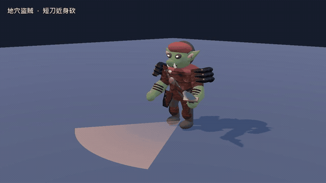

# I'm Noah Chien. I help move problems toward solutions.

[繁體中文](README.md)　／　**English**

**Target roles: Project Manager / Senior Software Engineer**　|　10+ years in software development

  

[Portfolio website](https://noahchien.github.io/portfolio/en.html)　·　[Engineering](projects/work.en.md)　·　[Background](about.en.md)　·　[Writing](projects/novel.en.md)　·　[Games](projects/cryptfall.en.md)

From speech applications to financial systems, my work has covered implementation, systems analysis, project planning, and coordination. What I'd like you to remember is **my ability to keep a difficult problem moving toward a solution, even in an unfamiliar domain or with limited resources**.

Colleagues often come to me when a project gets stuck. Sometimes the next step is clearer requirements; sometimes it's understanding why a case cannot be tested. And sometimes the most useful answer is a small tool that keeps a whole team from getting stuck in the same place again.

## Three projects to start with

> [!IMPORTANT]
> **FPGA development completed more than a year ahead of the original estimate**, after development staffing fell from three people to one. I owned planning, technical direction, code review, and validation.

| Project | The challenge | My responsibility and outcome |
| --- | --- | --- |
| **FPGA trading systems** | Took over a university foundation; integrated rules, hardware, and trading interfaces as staffing fell from three to one | Integration within five months; approximately 0.36 µs internal risk decisions. Separately led arbitrage-system validation: erroneous orders 60 to 0 in a same-night, same-data comparison. |
| **Virtual exchange** | Manual testing could not cover many edge cases; real incidents were difficult to reproduce | Built tooling for the risk-control development team, supporting scripted scenarios, automated stress tests, and replay of actual incidents from imported logs. |
| **Logger Monitor** | Multiple IT teams relied on manual log checks, with a risk of missed issues | Checks file existence and error keywords, supports team-specific INI settings, and sends notifications through LINE and Telegram Bot APIs. |

Together, they illustrate **project ownership, test design, and reusable tooling for teams**.

## 🔧 FPGA: take over a university foundation and integrate it on hardware

> [!NOTE]
> **Completed integration within five months after taking over a National Chiao Tung University project.** Existing research and code came from the university. I owned subsequent integration, development, and validation, rather than building everything independently from scratch.

### Pre-trade risk gateway | Integration and development lead

Moved existing price, credit-limit, inventory, and other risk checks into FPGA logic while establishing shared rules for development and validation.

| Focus | My work and outcomes |
| --- | --- |
| **Rules extraction** | Resolved 57 differences across two generations of existing systems and created machine-readable rules as a shared development and testing reference. |
| **Predictable latency** | FPGA-internal risk decisions took 109 cycles at 300 MHz, approximately **0.36 µs**; this is not end-to-end trading latency. |
| **Dual-reference validation** | Compared reference-model and FPGA decisions order by order, then hardware against simulation; 12 deliberately corrupted variants checked that the comparison detected faults. |
| **Trading integration** | Successful execution and cancellation in the TWSE test environment; retained original-order information to complete cancellation messages. |
| **Timing and recovery** | Timing closure at 300 MHz; handled sequence numbers, reconnection, and duplicate-submission risks, stopping for reconciliation when state was uncertain. |

### Options parity arbitrage | Hardware validation lead

The original system was developed by a university team. My responsibility was making it work correctly in the actual environment, not claiming the original system's development as my own.

- **Erroneous orders, 60 to 0:** traced stage counters to a variable synthesized into a constant. After correction, the same-night, same-market-data comparison went from 60 erroneous arbitrage orders to 0.
- **Instrument matches, 0 to 241,770:** corrected a market-data format and decoder mismatch, restoring successful matches in the reported observation.
- **Connectivity diagnosis:** traced a suspected hardware issue to an address conflict between the host and FPGA, then resolved the connection by changing the conflicting interface state.
- **Market-data services:** clarified aggregated versus tick-by-tick access and verified stable FPGA receipt of tick-by-tick data.

### People still own resource decisions and quality

When staffing fell from three people to one, I retained planning, progress tracking, and technical direction, using AI for most code implementation while reviewing output, checking the environment, and defining validation. Development progressed more than a year ahead of the original estimated schedule.

I use counters, packet captures, and hardware-versus-simulation comparisons to find evidence. Understanding the intended outcome comes before judging the result. This is the problem-solving responsibility I want to bring to a team.

**Technology:** `Alveo U50` · `HLS C++` · `10G Ethernet / TCP` · `FIX 4.4` · `300 MHz`

The system is a foundation for follow-on work and is not yet in production. Figures retain their measurement scope; a single comparison is not a claim of universal error-free behavior.

[Read the full FPGA case and measurement scope](projects/fpga.en.md)

> [!TIP]
> **Tools used by real teams:** the virtual exchange supports risk-control developers with **scripted edge cases, stress tests, and log replay**. Logger Monitor helps multiple IT teams with **configurable checks and LINE / Telegram notifications**.

## 🧪 Virtual exchange: make difficult cases reproducible

The risk-control development team had relied on manual testing. Many edge cases were difficult to cover, and even incidents that had already occurred in the real environment were hard to recreate.

I developed a virtual exchange so the team could:

- Write scripts to define special test scenarios.
- Run automated stress tests with less reliance on manual operation.
- Import real logs to reproduce events and support investigation.

The value is **turning a one-off incident into a scenario the team can observe and analyze again**.

[Read the testing-tools case study](projects/testing-tools.en.md)

## 🔎 Logger Monitor: take repeatable checks out of manual inspection

IT teams had been checking logs by hand, which left room for omissions. I developed Logger Monitor for use across multiple teams, with configurable checks and notifications.

| Check | Approach |
| --- | --- |
| File existence | Confirm that the expected log file exists |
| Error indicators | Look for configured keywords, such as ERROR, termination-related messages, and catch |
| Team-specific needs | Adjust checks through INI configuration |
| Notifications | Send alerts through LINE and Telegram Bot APIs |

The virtual exchange and Logger Monitor use technologies including Python and Node.js. They serve the risk-control development team and multiple IT teams respectively. I do not claim unmeasured time savings or zero missed alerts.

## What I can bring to the next team

| Capability | Experience behind it |
| --- | --- |
| **Break down an unfamiliar problem** | FPGA planning, implementation trade-offs, on-site checks, and validation decisions |
| **Adapt delivery to limited resources** | Reorganized AI-assisted implementation and review after staffing fell from three people to one |
| **Turn experience into reusable tools** | Scripted scenarios, log-based incident reproduction, and cross-team log monitoring |
| **Connect financial workflows with software** | Securities risk control and trading, trust services, and insurance payment platforms |
| **Connect requirements, development, and people** | Systems analysis, architecture and database design, code reviews, vendor progress, and requirements discussions |

## 🛠️ Technical background

- **Backend and systems:** Java/Spring, C/C++, Node.js, Python, JavaScript, REST APIs, and database design.
- **Development and delivery:** Git, Docker, Jenkins, Linux, and DevOps collaboration.
- **Other project experience:** MongoDB, Elasticsearch, data-observation platforms, and speech recognition and synthesis applications.
- **Recent focus:** FPGA projects, engineer-led AI collaboration, testing tools, and monitoring tools.

## Career experience

| Organization | Focus |
| --- | --- |
| Concord Securities · R&D Assistant Manager | Risk control and trading, development coordination, maintenance, workflow digitization |
| CTBC Bank · Engineer | Trust services, system upgrades, architecture, and testing |
| Fubon Life · Senior Specialist | Payment platforms, system and database design, code reviews, vendor coordination |
| Institute for Information Industry · Software Engineer | Frontend/backend development, data platforms, Redmine, and DevOps |
| NCCC, Cyberon, Inventec | Systems analysis, speech applications, mobile/Windows software, and production-line testing |

Computer Science graduate, National Chiao Tung University. [Read my background](about.en.md)

## Outside work, I'm creating worlds of my own

**[Watch the game videos](https://noahchien.github.io/portfolio/en.html#projects)**: monster rigs and attack wind-up at 0.6x speed, plus a half-speed mage casting preview. These are in-engine tests, not full normal-speed gameplay.

**Fiction and content tooling:** As stories grow, so do characters, settings, and loose threads. Git, outline checks, relationship maps, and mobile review pages help me keep the work connected. The finalized manuscript currently reaches Chapter 35; longer-term outlines and tooling remain in progress. [Writing project](projects/novel.en.md)

**Cryptfall:** A Godot prototype exploring procedural dungeons, class-based combat, equipment, and upgrade choices. It is a development prototype, not a released game. [Game project](projects/cryptfall.en.md)

## An attitude I want to keep

> Don't be afraid to make mistakes. Be afraid of repeating them.

I want each solved problem to leave behind something useful for the next one. That connects my work on testing tools, monitoring, and AI-assisted project delivery.

If your team needs someone who can understand a problem, work through it, and take responsibility for planning and delivery, these cases are an introduction to how I work.

---

Work cases describe the problem, my responsibilities, methods, and outcomes. Company code and internal materials are not published due to confidentiality requirements. Personal projects include AI-assisted work, with completed work and future plans clearly distinguished.
