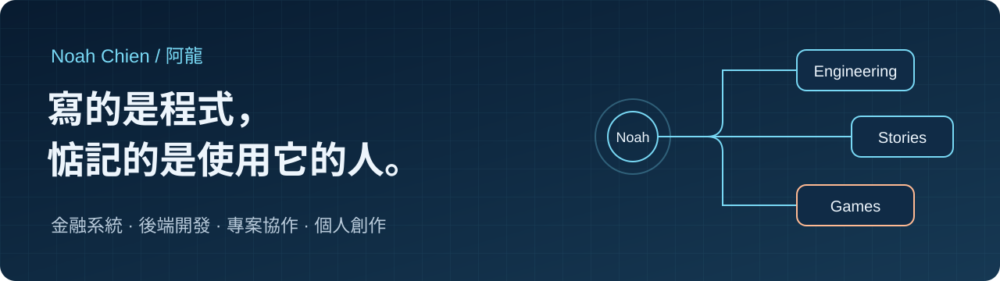
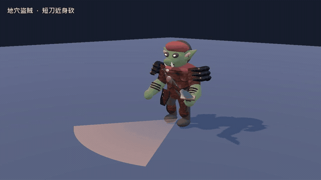

# 阿龍 Noah Chien

**繁體中文**　／　[English](README.en.md)

**專案主管／資深工程師**　｜　軟體開發十年以上

  

[作品集網站](https://noahchien.github.io/portfolio/)　·　[工程案例](projects/work.md)　·　[職涯背景](about.md)　·　[小說](projects/novel.md)　·　[遊戲](projects/cryptfall.md)

我做過語音應用、保險、信託與證券系統，從開發、系統分析做到專案規劃。現在在康和證券負責風控與交易系統，近期主要在做 FPGA 低延遲交易：交大五年期產學合作案，我在第三年中途接任專案 PM，之後開發人力由三人縮為一人，依原訂工期估算提前一年以上完成開發。

我擅長處理沒人熟悉、資源又不夠的問題：先把需求和現況釐清，找出真正卡住的地方，必要時自己寫工具，讓團隊不用一再卡在同一件事上。

## 代表成果

| 專案 | 問題 | 我做了什麼 |
| --- | --- | --- |
| **FPGA 下單前風控** | 要把券商的下單前風控搬進 FPGA，開發人力由三人縮為一人 | 主導規劃與開發，五個月從可行性評估做到證交所測試環境成交與刪單；FPGA 內風控判斷約 0.36 µs |
| **期權套利 FPGA 實機除錯** | 交大團隊開發的系統模擬全過，接上真實行情卻持續出錯 | 接手後段實機除錯與修正，同一晚同行情的對照測試中，錯誤委託由 60 筆降為 0 |
| **虛擬交易所** | 風控團隊靠手動測試，特殊案例測不到，線上問題難以重現 | 開發測試工具：腳本設定案例、自動壓測、匯入日誌重現事件 |
| **Logger Monitor** | 多個團隊靠人工看日誌，容易漏查 | 可設定的日誌檢查工具，異常時發 LINE／Telegram 通知 |

## FPGA 低延遲交易

交大原訂五年的產學合作案，我在第三年中途接任專案 PM，負責整合、開發與驗證。底下兩個系統，一個是接手後把交大的套利系統在實機上修到能用，一個是由我主導的新系統。

### 下單前風控閘道（主導）

每筆委託送出前，都要先檢查價格、額度、庫存等規則。過去由伺服器軟體處理，這個專案把檢查改成在 FPGA 上用固定時間完成。

| 重點 | 內容 |
| --- | --- |
| 規則整理 | 從兩代既有風控系統整理出 57 條差異，做成機器可讀的規則表，開發和測試都以它為準 |
| 延遲 | FPGA 內一筆委託的風控判斷為 109 個時脈（300 MHz），約 0.36 µs；這是 FPGA 內部處理時間，不含網路往返 |
| 驗證 | 同一批委託同時給現行系統的參考模型和 FPGA，逐筆比對准駁；上板後再比對實機與模擬，並用 12 種故意改壞的資料確認比對抓得到錯 |
| 交易所介接 | 在證交所測試環境完成登入、委託成交與刪單。刪單電文缺少原單資訊，我讓 FPGA 保留一份原單資料，刪單時在硬體內補齊 |
| 穩定性 | 300 MHz 時序收斂；處理連線序號與斷線重連，避免重複送單，狀態無法確認時先停下核對 |

規劃、技術方向、程式審查和驗證由我負責，實作大量使用 AI 工具輔助。系統目前是後續專案的基礎，還沒有正式上線。

`Alveo U50` · `HLS C++` · `10G Ethernet / TCP` · `FIX 4.4` · `300 MHz`

### 期權平價套利系統（主導後段實機除錯與修正）

系統由交大團隊在產學合作中開發。進入實機階段後問題不斷，後段的實機除錯、修正，以及串接期交所環境，由我主導完成。

- **錯誤委託 60 → 0**：逐段讀計數器，追到一個在硬體合成時被固定成常數的變數。修正後，同一晚、同一行情的對照測試中，錯誤委託由 60 筆降為 0。
- **商品比對 0 → 241,770 次**：確認行情格式和解碼器不符，修正後該次測試恢復正常比對。
- **串接期交所環境**：接上正式行情線，FPGA 自己直接登入期交所，期貨、選擇權兩個連線都完成登入。過程中連線時好時壞，原本懷疑硬體故障，查到是主機和 FPGA 用了同一個網路位址，關掉主機那張網卡後一次成功。
- **行情頻道**：釐清交易所彙整行情和逐筆行情的取得方式，並實測 FPGA 能穩定收到逐筆行情。

[完整 FPGA 案例與量測範圍](projects/fpga.md)

## 虛擬交易所

風控開發團隊原本靠手動測試，很多特殊案例測不到；線上發生過的問題，也很難重新製造出來除錯。

我寫了一個虛擬交易所給團隊用：

- 用腳本設定要測的特殊案例
- 自動跑壓力測試
- 匯入實際的日誌，把當時的事件重播出來

線上發生過一次的問題，現在可以在測試環境裡反覆重現、慢慢查。

[測試工具案例](projects/testing-tools.md)

## Logger Monitor

資訊部好幾個團隊原本靠人工巡日誌，難免漏看。我做了 Logger Monitor 給這些團隊共用：

| 檢查 | 做法 |
| --- | --- |
| 日誌檔是否存在 | 先確認該有的檔案都在 |
| 是否有異常 | 搜尋 ERROR、中止、catch 等關鍵字 |
| 各團隊需求不同 | 用 INI 設定檢查條件 |
| 通報 | 透過 LINE、Telegram Bot 發通知 |

虛擬交易所和 Logger Monitor 用 Python、Node.js 開發。

## 能力

| 能力 | 經驗 |
| --- | --- |
| 進入陌生領域 | FPGA 專案的規劃、實作取捨與實機驗證 |
| 人力不足時調整做法 | FPGA 專案人力由三人變一人，改用 AI 工具實作、自己負責審查與驗證 |
| 把經驗做成工具 | 腳本化測試、日誌重現、跨團隊日誌監控 |
| 金融業務 | 證券風控與交易、信託代理服務、保險給付平台 |
| 需求到交付 | 系統分析、架構與資料庫設計、程式審查、委外管理、需求溝通 |

## 技術

- **後端與系統**：Java／Spring、C／C++、Node.js、Python、JavaScript、REST API、資料庫設計
- **開發環境**：Git、Docker、Jenkins、Linux、DevOps
- **其他**：MongoDB、Elasticsearch、資料觀測平台、語音辨識與合成
- **近期**：FPGA（HLS、Alveo）、測試與監控工具

## 經歷

| 公司 | 工作 |
| --- | --- |
| 康和綜合證券｜RD 副理 | 風控與交易系統、開發管理與維運、作業電子化 |
| 中國信託｜襄理工程師 | 信託代理服務維運、系統升級、架構規劃與測試 |
| 富邦人壽｜資深專員 | 給付平台、系統與資料庫設計、程式審查、委外協作 |
| 資策會｜軟體工程師 | 前後端、資料平台、Redmine 與 DevOps |
| 聯合信用卡中心、賽微科技、英業達 | 系統分析、語音應用、行動／Windows 軟體、產線測試 |

交通大學資訊工程系畢業。[完整背景](about.md)

## 工作以外

**[遊戲影片](https://noahchien.github.io/portfolio/#projects)**：怪物骨架與攻擊前搖（0.6 倍速），以及法師半速施法預覽，都是引擎內測試畫面。

**長篇小說**：故事越寫越長，角色、設定和伏筆也越來越多，我用 Git、章綱檢核、人物關係圖和手機審稿來管理。正文寫到第 35 章。[創作案例](projects/novel.md)

**地城餘燼 Cryptfall**：用 Godot 做的隨機地城原型，有職業戰鬥、裝備和升級選擇，還在開發中。[遊戲案例](projects/cryptfall.md)

## 做事的原則

> 不要害怕犯錯，要害怕犯同樣的錯。

解決一個問題，我會順手把方法留下來，下次遇到就不用從頭查。

---

工作案例只說明問題、我的角色、做法與成果；公司程式碼與內部資料受保密規範限制，不公開。
